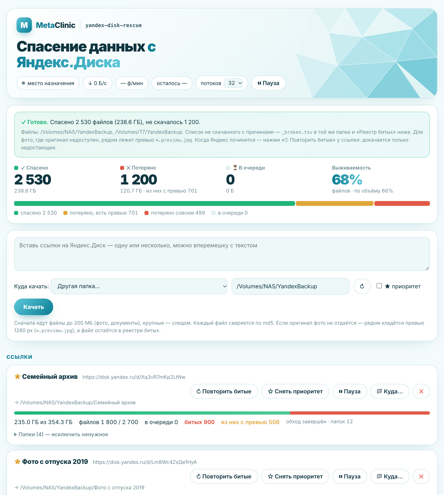

# yandex-disk-rescue

*Сделано в [MetaClinic](https://meta-clinic.ru) — открытый инструмент, бесплатно, MIT.*

Спасение данных с Яндекс.Диска по публичным ссылкам — на NAS, внешний HDD/SSD или этот компьютер.
Качает сотни гигабайт параллельно, проверяет каждый файл по md5, докачивает после обрывов, а то, что
Яндекс не отдаёт, записывает в реестр — с превью вместо недоступных фото. Работает как **skill для
ИИ-агентов** (Claude Code и совместимых) и как обычная утилита.

> Rescue Yandex Disk public links to a NAS, external drive or local disk: progress web UI, md5
> verification, resumable segmented downloads, a broken-file registry and preview fallback for
> unreadable photos. Agent skill + standalone tool, Python stdlib only. Docs are in Russian.



> ☕ **Пока есть что качать, компьютер не уснёт** — утилита сама запрещает сон (macOS, Linux,
> Windows). Всё скачалось или стоит пауза — запрет снимается. На ноутбуке **не закрывайте крышку**:
> так он уснёт всё равно, и загрузка встанет.

## Зачем

Сделано в ночь, когда у Яндекс.Диска массово перестали читаться файлы на части узлов хранилища.
Обычное скачивание в такой ситуации бесполезно: файлы висят без ответа, обрываются на середине,
веб-интерфейс Диска их тоже не отдаёт. Утилита вытаскивает всё, что ещё живо, и честно
показывает, что потеряно.

## Вариант 1. Через ИИ-агента (skill)

Подходит, если у вас есть Claude Code или другой агент, который может запускать команды на вашем
компьютере. Агент сам спросит, куда качать, проверит свободное место, запустит утилиту и откроет
страницу прогресса.

**Установите скилл** (один раз):

```bash
git clone https://github.com/GinaliArseny/yandex-disk-rescue ~/.claude/skills/yandex-disk-rescue
```

Или не устанавливайте, а просто дайте агенту ссылку на этот репозиторий. Готовый пакет `.skill`
для claude.ai — в Releases.

**Попросите**, например так:

> Скачай эти ссылки с Яндекс.Диска на внешний диск: https://disk.yandex.ru/d/… https://disk.yandex.ru/d/…
> Держи руку на пульсе: каждые 10–15 минут проверяй ошибки и скорость, разбирайся с паузами и
> ложными «битыми», коротко докладывай мне, что происходит.

Последняя фраза важна: при массовых сбоях на стороне Яндекса загрузка идёт часами, и что-то может
пойти не так — отвалится шара, моргнёт сеть. Скилл объясняет агенту, на что смотреть и как это
чинить, но следить он будет, только если вы попросите.

> Агент должен работать **на том же компьютере**, что видит ваш NAS или диск (Claude Code в
> приложении или терминале). Облачный чат в браузере до домашнего диска не дотянется.

## Вариант 2. Самостоятельно через терминал

Нужен только Python 3.8+ — на macOS и Linux он уже есть, на Windows ставится с python.org.

1. **Откройте терминал.** macOS: `Cmd+Пробел` → «Терминал». Linux: `Ctrl+Alt+T`.
   Windows: `Win` → «PowerShell».
2. **Проверьте Python:**
   ```bash
   python3 --version
   ```
   Должно быть `Python 3.8` или новее. Если macOS предложит установить «инструменты разработчика» —
   согласитесь. Windows: команда `py --version`; если Python нет — поставьте с
   [python.org](https://www.python.org/downloads/) с галочкой «Add python.exe to PATH».
3. **Скачайте утилиту** — командой ниже или кнопкой *Code → Download ZIP* на этой странице
   (распакуйте в домашнюю папку как `yandex-disk-rescue`):
   ```bash
   git clone https://github.com/GinaliArseny/yandex-disk-rescue ~/yandex-disk-rescue
   ```
4. **Если качаете на NAS или внешний диск — подключите его** (macOS: Finder → `Cmd+K` →
   `smb://адрес-NAS`; Windows: «Подключить сетевой диск» в Проводнике).
5. **Запустите:**
   ```bash
   cd ~/yandex-disk-rescue/scripts && python3 app.py
   ```
   Windows: `cd $HOME\yandex-disk-rescue\scripts; py app.py`. В ответ появится строка вида
   `Интерфейс: http://localhost:8765 · куда можно качать: …`. **Терминал не закрывайте** — пока он
   открыт, идёт загрузка, а компьютер не уснёт.
6. **Откройте в браузере** http://localhost:8765, вставьте ссылки, выберите «Куда качать» —
   и нажмите «Качать».

Остановить — `Ctrl+C` в терминале. Продолжить — та же команда из шага 5: всё уже скачанное
пропустится, работа продолжится с того же места.

## Как это проходит

1. **Вставьте ссылки** — одну или пачку, можно вперемешку с текстом (подходят `disk.yandex.ru/d/…`,
   `disk.360.yandex.ru/d/…`, `yadi.sk/d/…`).
2. **Выберите «Куда качать»** — утилита сама находит подключённые NAS и внешние диски и показывает
   свободное место. Разным ссылкам можно назначить разные места; поменять потом — «📁 Куда…».
3. **Следите за табло**: спасено / потеряно / с превью, скорость и файлы в минуту. Сначала идут
   фото и документы, крупные видео и архивы — следом, кусками в 8 соединений.

   > ⚠️ **Скорость и «осталось» — СУПЕР ориентировочные.** Они зависят от состояния хранилища
   > Яндекса (живой файл приходит за секунды, мёртвый — проверяется и отсеивается), вашего
   > интернета, VPN и диска. В нашем прогоне скорость прыгала от 1 до 16 МБ/с, а оценка
   > «осталось» показывала почти 9 часов, когда до конца оставалось меньше 2 (и это вместе с
   > перезагрузкой посередине). Ориентируйтесь на полосу прогресса и число файлов, а не на МБ/с.
   Ненужные папки можно исключить («Папки → ✕ Исключить»), важные ссылки — поднять «★ В приоритет».
4. **«✓ Готово»** — когда очередь опустела, наверху появится итог: сколько спасено, где лежит и что
   делать с остальным.

Если ссылка не открывается (опечатка, сняли с публикации, доступ только приглашённым), в её карточке
будет красная плашка с объяснением. Ошибочно добавленную ссылку убирает «✕» — скачанные файлы
при этом остаются на диске.

## Где результат

```
<место назначения>/
  _broken.tsv                     — реестр того, что не скачалось, с причинами (обновляется каждые 30 с)
  <имя папки по ссылке>/
    2019 Дача/IMG_0042.JPG        — целый файл, сверен по md5
    2019 Дача/IMG_0043.JPG.preview.jpg  — оригинал недоступен, сохранено превью до 1280 px
    Видео/VID_0007.MP4.part       — частично отданный файл (+ .part.json — план докачки)
```

## Что делать с битыми

В реестре у каждого файла причина:

| Причина | Что значит |
|---|---|
| `NO_RESPONSE` | Узел хранилища не отдаёт этот файл (сами узлы при этом могут быть живы) |
| `PARTIAL` | Отдаётся только начало файла; скачанное лежит в `.part` |
| `превью тоже недоступно (434)` | Превью у Яндекса так и не сгенерировали — взять нечего |
| `Сеть …`, `HTTP 500` | Временные сбои — стоит повторить |

Когда Яндекс восстановит хранилище — нажмите **«↻ Повторить битые»** у ссылки: проверятся только
битые, докачается только недостающее, превью заменятся оригиналами.

## Остановить и продолжить

`Ctrl+C` в терминале останавливает, та же команда запуска продолжает с того же места: состояние
хранится в `state.db` рядом со скриптом, уже скачанное пропускается.

Пока есть что качать, утилита не даёт компьютеру уснуть (на странице горит «☕ сон отключён»);
когда всё скачано или стоит пауза — снова разрешает. Крышку ноутбука не закрывайте.

## На каких системах работает

| Система | Статус |
|---|---|
| **macOS** | Проверено в бою: сотни гигабайт, NAS по SMB, внешние диски |
| **Linux** | Должно работать — только стандартный Python, диски находятся через `mount`, сон — через `systemd-inhibit`. Вживую не проверялось |
| **Windows** | Поддержка добавлена (диски по буквам, сетевые диски, запрет сна, запретные имена файлов), но **не проверялась** — будем рады отзывам. Очень длинные пути (>260 символов) могут потребовать включить в Windows «длинные пути» |

## Если что-то не так

- **Диск в списке помечен «нет прав на запись», хотя подключён** (macOS) — система не пускает
  процесс к сетевым томам, внешним дискам и «Загрузкам»/«Документам». Запустите утилиту из
  обычного Terminal.app или выберите папку `~/YandexBackup`.
- **Загрузка сама встала на паузу** — отвалился диск или шара. Переподключите и нажмите «▶ Продолжить»;
  файлы, на которых это случилось, не считаются битыми.
- **МБ/с низкие, а прогресс идёт** — на мелких файлах так и есть, смотрите счётчик «ф/мин»
  (и помните: скорость здесь очень приблизительная).
- **Шара SMB «залипла» намертво** (macOS, Finder висит) — помогает только перезагрузка; держите
  потоков ≈32, утилита по умолчанию бережёт шару.

## Что внутри

| Файл | Что это |
|---|---|
| `SKILL.md` | Инструкция для агента: запуск, HTTP API, проверенное поведение Яндекса, грабли окружения |
| `references/yandex-behavior.md` | Форма ответов публичного API Диска, коды ошибок, превью, замеры |
| `scripts/app.py` | Сервер: обход ссылок, очередь, загрузка, реестр битых, HTTP API |
| `scripts/index.html` | Веб-интерфейс |

Переменные окружения (необязательно): `PORT` (8765), `NAS_ROOT` (место по умолчанию),
`DB_PATH` (где хранить состояние), `HEADERS_TIMEOUT` (5 с — сколько ждать ответа узла).

Не связано с Яндексом; используется только публичный REST API Диска.

## Лицензия

MIT
